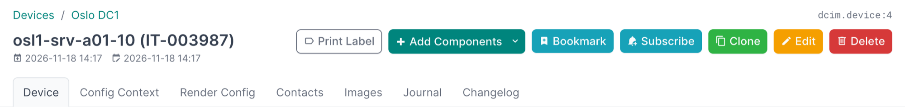
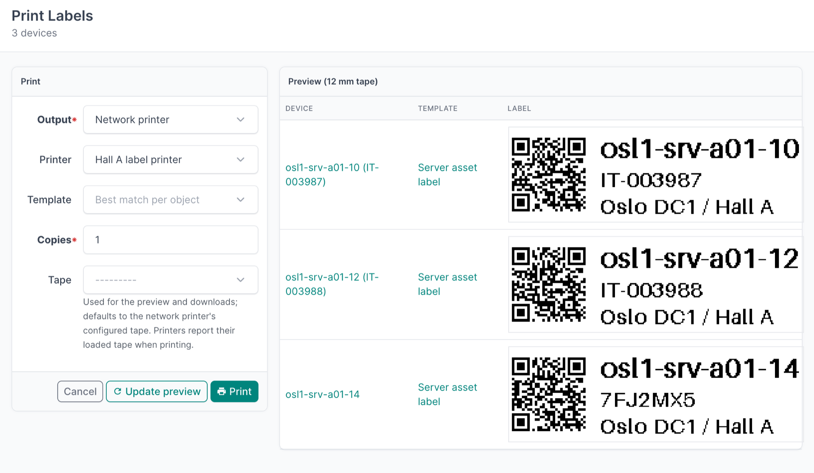
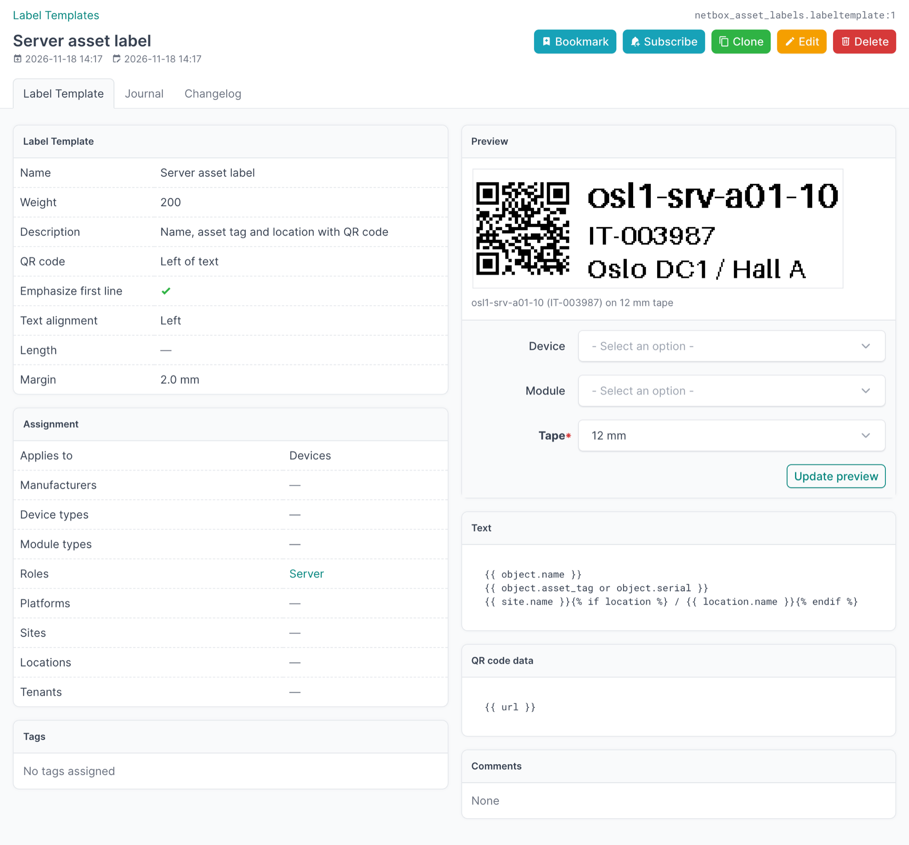

# NetBox Asset Labels

A NetBox plugin that prints asset labels for **devices and modules** on Brother P-touch label printers over the network or locally for the user.

- A **Print Label** button on device and module pages, and a **Print Labels** button on the device and module lists. The list button prints the selected rows, or everything matching the current filters when nothing is selected.
- Each print shows a preview of every label before anything is printed.
- **Label templates** define the content (Jinja2 text lines plus an optional QR code). Templates are assigned by manufacturer, device type, module type, device role, platform, site, location and tenant. When several templates match, the highest weight wins.
- Three outputs, chosen on the print page:
  - **Network printer:** NetBox sends the labels to the printer over the network.
  - **USB printer on this computer:** the browser sends them to a printer plugged into the user's computer (WebUSB).
  - **Download:** a PDF or PNG of the labels, to print with Brother's own software.
- When printing, the printer is asked which tape is loaded, and labels are rendered for it. Printer errors (no tape, cover open, …) are reported back.
- REST API for templates, printers, printer status and printing.

Requires NetBox 4.7 or later.

> [!AI disclaimer]
> AI tools were used in developing this plugin, including its code, tests and documentation. It is provided as is, without warranty or guarantee of any kind. Test it in your own environment before relying on it, and use it at your own risk.

## Screenshots

**Print Label** button on a device page:



The print page, with output options and a preview of each label:



A label template, with a live preview for any device or module:



## Printers

Tested with the **PT-E550W**.

Other Brother P-touch printers should work if they meet these requirements:

- **Print head:** 128 pins at 180 dpi, for tapes up to 24 mm.
- **Commands:** Brother's P-touch raster command set, as described in the *Raster Command Reference PT-E550W/P750W/P710BT*. This covers print information, auto cut, half cut, margins and TIFF (PackBits) compression.
- **Status:** the printer answers status requests with the standard 32-byte reply.
- **Connection:**
  - Network printing needs a network interface that accepts raw print data on TCP port 9100, as on the PT-E550W and PT-P750W.
  - USB printing needs a USB printer interface. This makes USB-only models such as the PT-P710BT or PT-E560BT candidates, but they are untested.
  - Bluetooth isn't supported.

Tapes: 3.5, 6, 9, 12, 18 and 24 mm (TZe laminated and non-laminated).

When adding a network printer that isn't in the model list, choose **Other compatible printer**. The model is only informational; the same driver is used for every model.

Reports of other printers that work, or don't, are welcome.

### Network printing

NetBox sends raw raster data to the printer on **TCP port 9100**. The NetBox server/container must be able to reach the printer on that port. On the E550W, use the printer's network settings, or Brother's web interface/BRAdmin, to give it a fixed IP address.

### USB printing (WebUSB)

The browser talks to a printer connected to the user's own computer:
- It asks the printer which tape is loaded.
- NetBox renders and encodes the labels for that tape.
- The browser sends the result to the printer.

No setup in NetBox is needed, and no printer has to be added.

- **Browser:** Chrome or Edge. Firefox and Safari don't support WebUSB.
- **HTTPS:** NetBox must be served over HTTPS, or opened as `localhost`.
- **First use:** the browser asks once which USB device to use. After that the printer is found automatically.
- **macOS:** works without any setup.
- **Windows:** Brother's printer driver claims the printer, so the browser can't open it. Install the generic *WinUSB* driver for the printer instead (for example with [Zadig](https://zadig.akeo.ie/)). That device then no longer works with P-touch Editor or Brother's driver.
- **Linux:** allow the browser to access the device with a udev rule, and unload or blacklist the `usblp` kernel module if it claims the printer:
  ```
  SUBSYSTEM=="usb", ATTR{idVendor}=="04f9", MODE="0666"
  ```
- **P-touch Editor Lite:** if the printer has this mode (it shows up as a USB drive), turn it off.

### Download

- **PDF:** one page per label, each page exactly the size of the label on the tape (tape width × label length).
- **PNG:** one 180 dpi image, or a ZIP of images when there are several labels.

Print the file with Brother's driver or P-touch Editor, with the matching tape selected.

## Installation

Install the plugin into NetBox's virtualenv, from a release tag or a checkout:

```bash
pip install https://github.com/mgrytbak/netbox-asset-labels/archive/refs/tags/v0.2.0.tar.gz
# or
pip install /path/to/netbox-asset-labels
```

Enable it in `configuration.py`:

```python
PLUGINS = ['netbox_asset_labels']
```

Then run `manage.py migrate` and restart NetBox.

### netbox-docker

Add the plugin to `plugin_requirements.txt` and enable it in `configuration/plugins.py`, as described in [Using Netbox Plugins](https://github.com/netbox-community/netbox-docker/wiki/Using-Netbox-Plugins):

```txt
netbox-asset-labels @ https://github.com/mgrytbak/netbox-asset-labels/archive/refs/tags/v0.2.0.tar.gz
```

The NetBox image has no `git`, so use an archive URL like the one above rather than `git+https://…`.

## Configuration

All settings are optional:

```python
PLUGINS_CONFIG = {
    'netbox_asset_labels': {
        # Absolute NetBox URL used in QR codes ({{ url }}). Defaults to the URL of the request.
        'netbox_url': 'https://netbox.example.com',
        # TrueType fonts for label text. Defaults to Pillow's built-in sans-serif font,
        # whose bold is simulated.
        'font_path': '/opt/fonts/DejaVuSans.ttf',
        'bold_font_path': '/opt/fonts/DejaVuSans-Bold.ttf',
        # Seconds to wait for the printer
        'printer_timeout': 5,
    },
}
```

Set `netbox_url` if users reach NetBox through different hostnames, or through a reverse proxy that changes the host. Otherwise the QR codes contain whatever URL the printing user happened to use.

## Usage

1. **Plugins → Label Printers → Add**: name, model, IP address, the tape usually loaded, and cut mode.
   - The printer page shows its live status and loaded tape.
   - The configured tape width is only used if the printer doesn't report its loaded tape.
2. **Plugins → Label Templates → Add**: define the label content and which objects it applies to. Without any templates, a built-in default is used: name, asset tag or serial, and a QR code linking to the object.
3. On a device or module, click **Print Label**. On a list, select rows and click **Print Labels**.
   Then choose the **Output**: network printer, USB printer on this computer, or download. The page remembers your last choice.
   - **Tape** sets the width used for the preview and for downloads.
   - **Cut mode** applies to USB printing; network printers use their own setting.

### Cut modes

| Mode | Result |
| --- | --- |
| Full cut, with half-cut peel tab | Each label is cut off, with a half cut in its margin to make the backing easy to peel |
| Full cut after each label | Each label is cut off |
| No cut | Tape is fed out without cutting |

Printing a strip of labels joined by half cuts is not supported yet: the PT-E550W turns half cuts into peel tabs when it cuts every label. [`tools/cut_test.py`](tools/cut_test.py) prints test strips with different cut settings, for finding the combination that produces a strip.

### Templates

Each non-empty line of **Text** becomes a line on the label. The text is sized automatically to fill the tape height, and the first line can be emphasized (larger and bold).

**QR code data** is encoded into a QR code left or right of the text. It defaults to the object's URL.

Both fields are Jinja2 templates with these variables:

| Variable | Value |
| --- | --- |
| `object` | The device or module being labelled |
| `device` | The device, or the module's parent device |
| `module` | The module, or `None` for devices |
| `site`, `location`, `rack`, `tenant`, `role` | Taken from the device |
| `url` | Absolute URL of the object in NetBox |

Examples:

```jinja
{{ object.name }}
{{ object.asset_tag or object.serial }}
{{ site.name }} / {{ location.name }}
```

```jinja
{# Module label #}
{{ object.module_type.model }}
S/N {{ object.serial }}
{{ device.name }} – {{ object.module_bay.name }}
```

Custom fields are available as `object.cf.<name>`.

**Length** fixes the label length; the text shrinks to fit. Leave it empty to make the label as long as its content. **Margin** is the blank tape before and after the content.

### Which template is used

Matching works like NetBox config contexts. A template applies to an object if, for every assignment field, the field is either empty or contains the object's value.

- Nested objects also match their parents: a template assigned to a location applies to devices in its child locations. The same holds for nested roles and platforms.
- Device types only match devices, and module types only modules.
- Every other field is taken from the device; for a module, from its parent device.
- If several templates match, the one with the highest **weight** wins, then the name decides.

When printing, you can also pick one template to use for all labels.

### Permissions

Printing on a **network printer** requires the custom **`print`** action on the label printer.

- Add `print` under *Additional actions* in an object permission for *Asset Labels › label printer*.
- Constraints work as usual, e.g. `{"name": "Warehouse"}` to allow printing on one printer only.
- Superusers can always print.

USB printing and downloads only need `view` permission on the devices and modules. Users without any printer they may print on only get these two options.

## REST API

Base path: `/api/plugins/asset-labels/`

| Endpoint | |
| --- | --- |
| `printers/`, `templates/` | Standard CRUD |
| `GET printers/<id>/status/` | Live printer status and loaded tape |
| `POST printers/<id>/print/` | Print labels |

```bash
curl -X POST https://netbox.example.com/api/plugins/asset-labels/printers/1/print/ \
  -H "Authorization: Bearer $TOKEN" -H "Content-Type: application/json" \
  -d '{"devices": [12, 13], "modules": [7], "copies": 1}'
```

`template` (an ID) optionally forces one template for all labels.

The response has a `detail` message, the label `count`, the `tape_width` used, and whether the tape was detected (`tape_detected`) and printing was `confirmed` by the printer.

Errors return:
- `400` for invalid input or a template error
- `503` if the printer is unreachable or reports an error

## Development

`ptouch.py` (raster protocol) and `layout.py` (label rendering) don't depend on Django. The tests still import the plugin package, so they run in the NetBox image. From the repository root:

```bash
docker run --rm --entrypoint "" -v "$PWD":/src -w /src -e PYTHONPATH=/opt/netbox/netbox \
  netboxcommunity/netbox:v4.7.4 sh -c '
    uv pip install -q -p /opt/netbox/venv/bin/python segno &&
    /opt/netbox/venv/bin/python -m unittest discover -s tests -t .'
```

The tests decode the generated printer data back into an image and compare it with the input.

To create migrations after changing models:

```bash
KEY=$(printf 'x%.0s' {1..50})
docker run --rm --entrypoint "" -v "$PWD":/src -w /opt/netbox/netbox -e PYTHONPATH=/src -e DEVELOPER=true \
  -e SECRET_KEY=$KEY -e API_TOKEN_PEPPER_1=$KEY -e DB_PASSWORD=x \
  netboxcommunity/netbox:v4.7.4 sh -c '
    uv pip install -q -p /opt/netbox/venv/bin/python segno &&
    echo "PLUGINS = [\"netbox_asset_labels\"]" > /etc/netbox/config/plugins.py &&
    /opt/netbox/venv/bin/python manage.py makemigrations netbox_asset_labels'
```

The migration files are written to `netbox_asset_labels/migrations/` in your checkout. No database is needed.

### Releasing

The version is `__version__` in `netbox_asset_labels/__init__.py`. Bump it, commit, and tag the commit with the same version (`v0.2.0`), so installs can pin the tag's archive URL.

The raster protocol follows Brother's *Raster Command Reference PT-E550W/P750W/P710BT*.

## License

[MIT](LICENSE). Provided as is, without warranty (see the [AI disclaimer](#netbox-asset-labels) above).
